# NewsRecommendation
校园新闻推荐系统 系统亮点：DeepSeek新闻助手、 Redis热词排行榜、个性化推荐算法、 ECharts运营分析、互动与实时通知、新闻运营闭环； 角色：用户、新闻编辑者、管理员；

所有源码均本人开发，项目是前后端分离的，所有的项目都具备了完整的业务逻辑，不仅仅局限于基础的增删改查（CRUD）操作，系统亮点众多。

本文注重于计算机毕业设计选题指导，列出题目均有源码， 大家可以去【公众号】(毕业终点站)获取或者加我【qq】(2112698948)提意见(别忘记Star哟)。备注：git

声明：仅用于学习使用，请勿用于任何商业行为！

1.系统非商用，非开源，非无偿。

2.由本人开发，如需源码，请联系以下方式，qq:2112698948。

3.项目有很多，并未全部上传，如果未找到想要的，可直接咨询。

# 校园新闻推荐系统

**Spring Boot 3 + Vue 3 前后端分离 · 超级管理员 / 新闻编辑 / 普通用户 三角色协作**

DeepSeek 新闻助手 · 个性化推荐 · 热词排行榜 · 运营分析 · 互动与实时通知

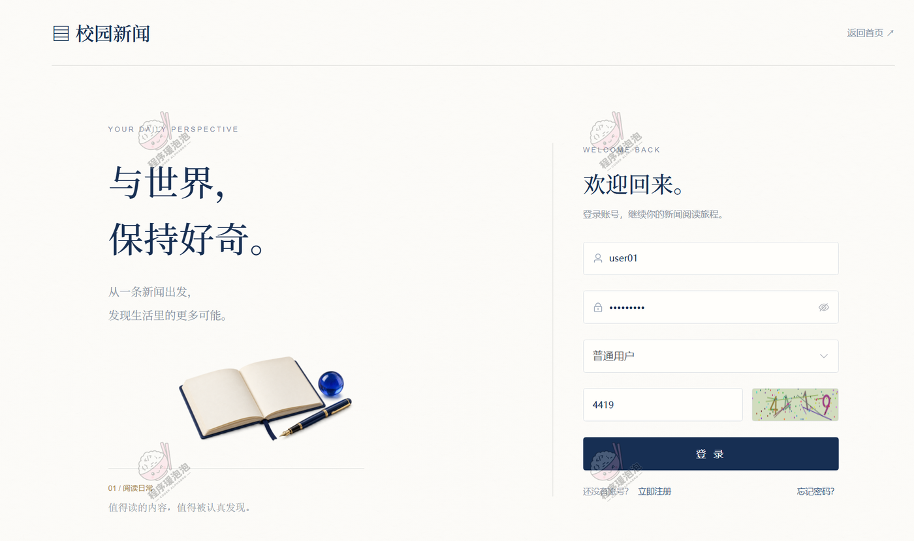

---

## 一、系统亮点

- 🎯 **个性化推荐算法**：基于兴趣标签匹配、已读过滤与互动热度加权推荐新闻，热度分数按「阅读量 ＋ 点赞数×3 ＋ 评论数×5」计算；未设置兴趣或匹配内容均已读时改推热门新闻，兼顾个人偏好与内容热度。
- 🤖 **DeepSeek 新闻助手**：通过 LangChain4j 接入 DeepSeek，检索站内相关新闻作为回答资料，用 SSE 逐字输出中文回复，帮用户从提问快速找到有用资讯。
- 📝 **新闻运营全流程**：从富文本编辑、栏目标签维护到审核通过、驳回反馈与下架管理，覆盖内容发布及后续维护的各个环节。
- 💬 **互动与实时通知**：点赞、收藏、阅读和评论记录都关联到具体新闻，评论带敏感词过滤，并通过 WebSocket 推送通知，用户能及时看到互动反馈。
- 📊 **ECharts 运营分析**：7 张图表展示发布、阅读、栏目、热门内容、用户活跃度与增长情况，结合 HanLP 中文分词词云，帮管理者了解内容主题和阅读表现。

---

## 二、技术选型

| 分类 | 技术 |
| --- | --- |
| 系统架构 | B/S、MVC、前后端分离、Web 用户端 + 管理后台，超级管理员 / 新闻编辑 / 普通用户三类角色 |
| 系统环境 | Windows |
| 开发环境 | IDEA、JDK 17、Maven、MySQL、Redis、Node.js |
| 后端技术 | Java、Spring Boot 3、Spring MVC、MyBatis-Plus、MySQL、Redis、JWT、WebSocket |
| 前端技术 | Vue 3、Vite、Element Plus、Vue Router、Pinia、Axios、ECharts、AIEditor、SCSS |
| 智能交互与分析 | DeepSeek、LangChain4j、SSE 流式输出、HanLP 中文分词、新闻词云 |

---

## 三、系统角色与功能

| 角色 | 主要功能 |
| --- | --- |
| 普通用户 | 注册登录与资料维护、首页轮播与公告、个性化推荐、热门与最新新闻、关键词搜索与栏目筛选、标签浏览、新闻详情与相关推荐、点赞收藏评论回复、AI 助手问答、消息中心、兴趣偏好设置、阅读历史与我的收藏 |
| 新闻编辑 | 新闻正文 / 摘要 / 来源 / 封面 / 标签维护、查看审核状态与驳回原因、评论查看回复与删除、个人资料与密码管理 |
| 超级管理员 | 数据看板（用户与新闻总量、今日阅读、新增用户、待审核、评论总量、DeepSeek 余额）、统计分析、账号与角色管理、新闻管理与审核下架、栏目 / 标签 / 轮播图 / 公告管理、互动记录管理、兴趣标签与消息通知、敏感词与系统配置、操作日志 |

---

## 四、系统实现（核心截图）

### 4.1 普通用户端

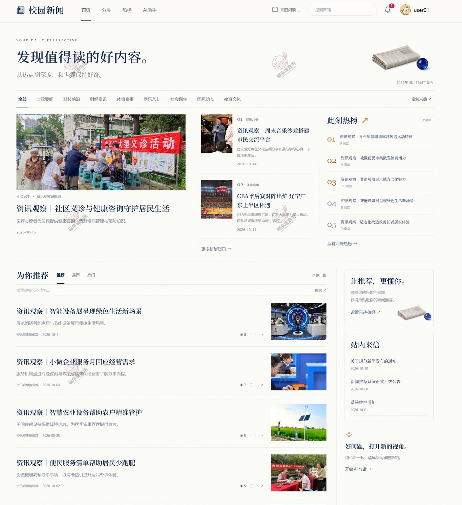

<b>首页（轮播图 · 个性化推荐 · 热门 / 最新新闻）</b>

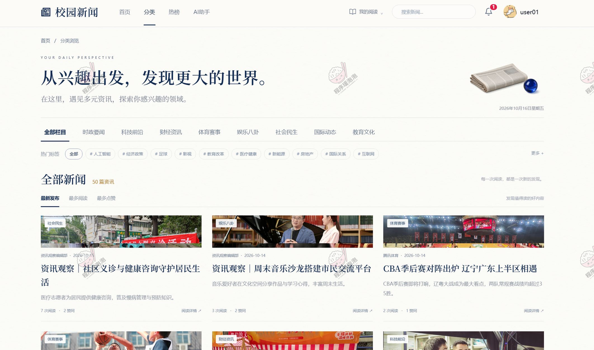

<b>新闻分类</b>

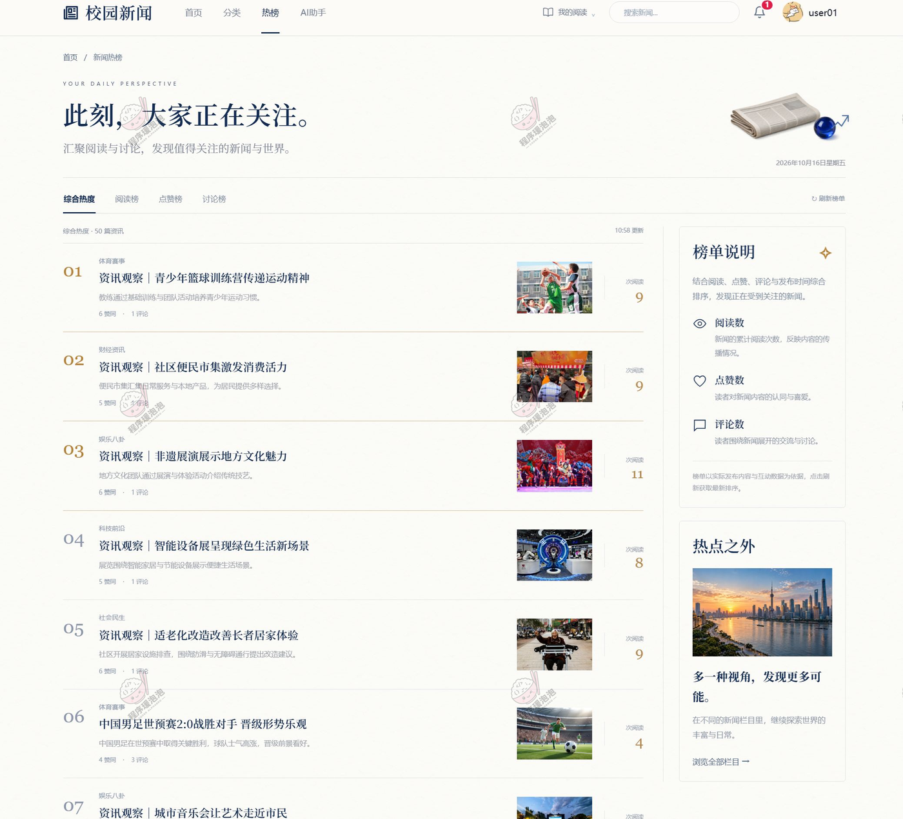

<b>热榜</b>

<b>新闻详情</b>

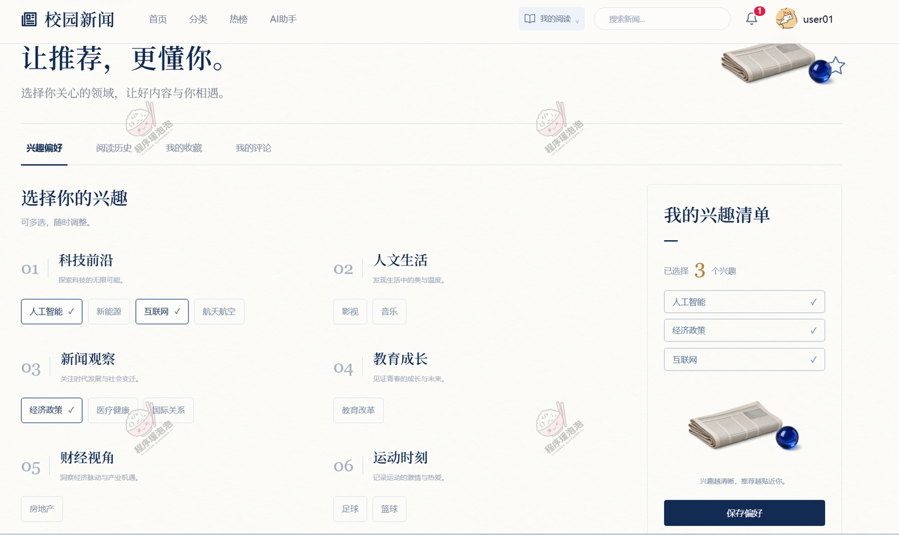

<b>兴趣偏好</b>

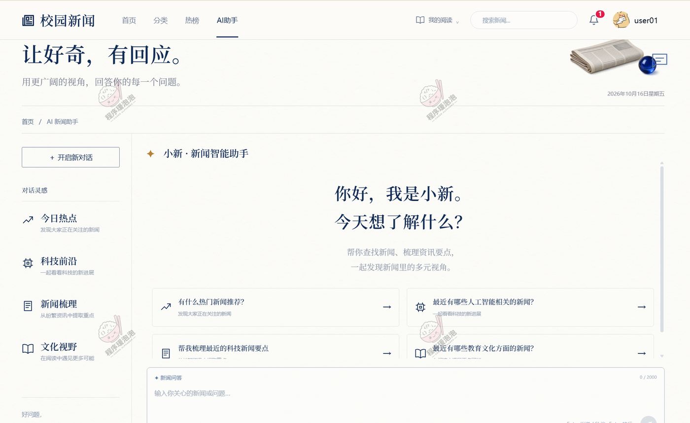

<b>AI 问答</b>

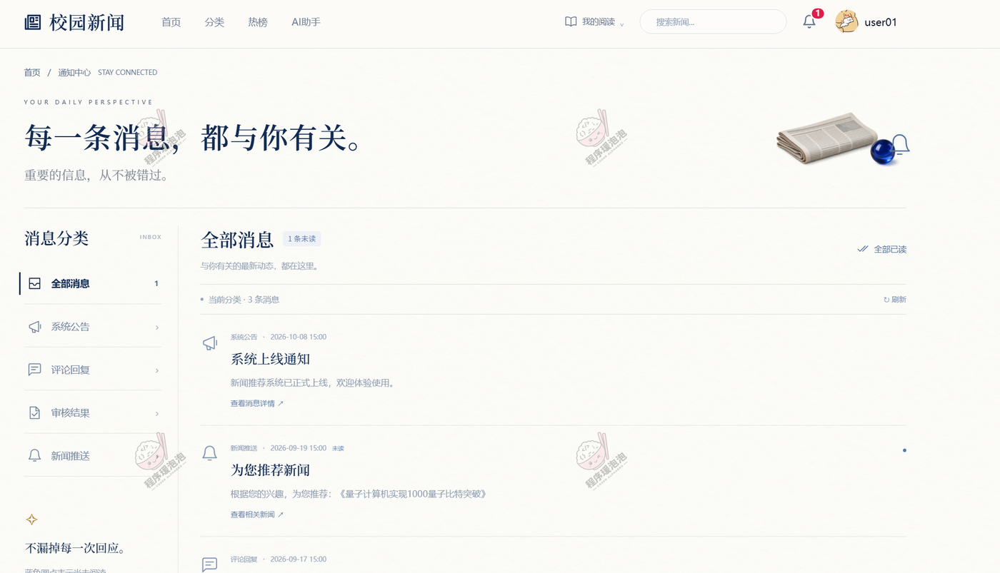

<b>通知中心</b>

用户端其余页面：阅读历史、我的收藏、我的评论、修改资料与找回密码。

### 4.2 新闻编辑端

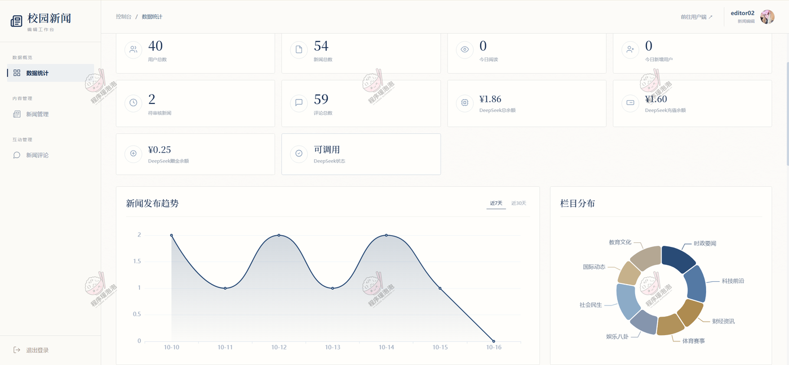

<b>数据分析</b>

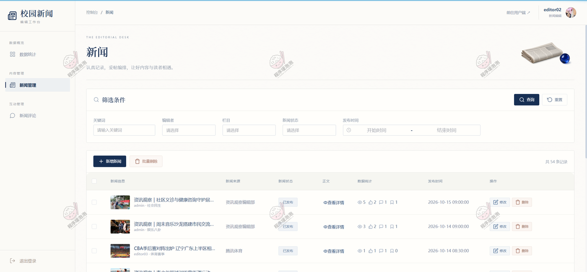

<b>新闻管理</b>

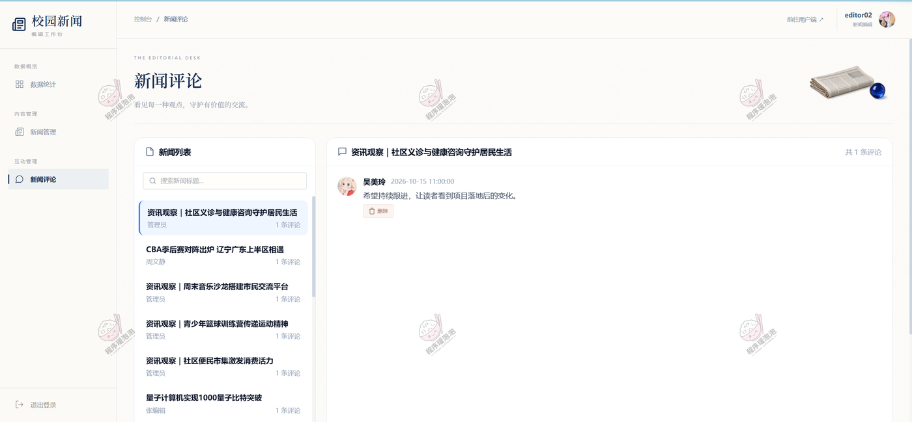

<b>新闻评论</b>

编辑端其余页面：个人设置、密码修改。

### 4.3 管理员端

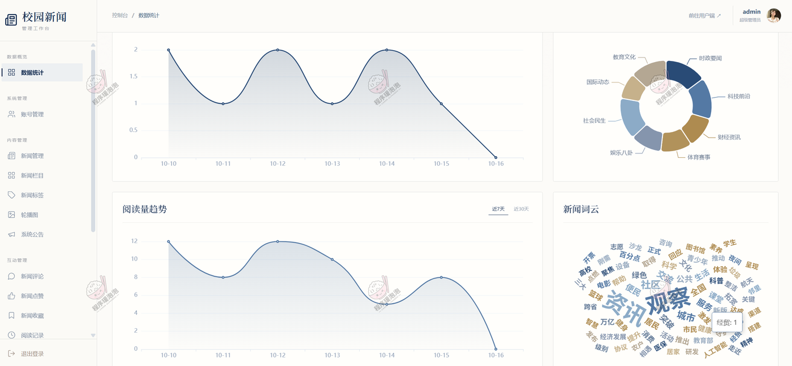

<b>数据分析</b>

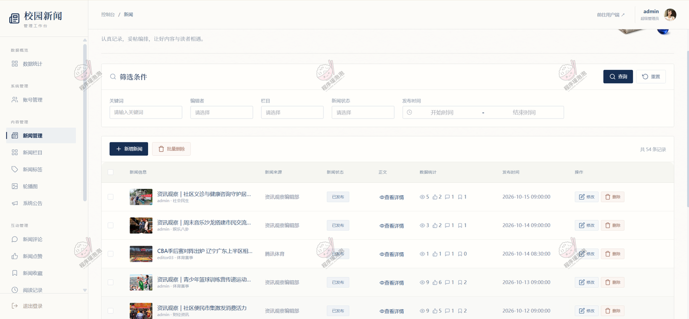

<b>新闻管理</b>

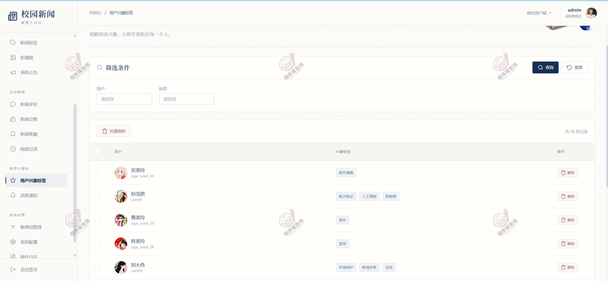

<b>用户兴趣标签</b>

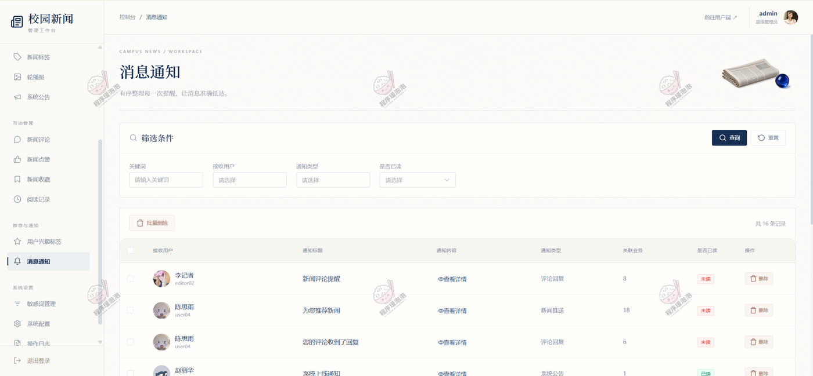

<b>消息通知</b>

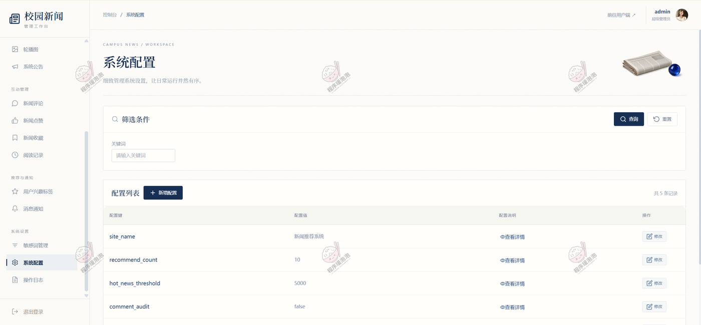

<b>系统配置</b>

管理员端其余页面：新闻评论、阅读记录、账号与角色管理、栏目与标签管理、轮播图与公告、敏感词管理、操作日志。

---

## 五、关于本项目

本文档展示的是系统核心功能截图，完整源码、数据库脚本和部署说明不在仓库内展示。截图均存放于本地 `images/` 目录，不依赖外部图床。

如需了解完整功能、获取源码或定制开发，欢迎联系。

**文档展示 16 张截图，需要了解更多，请联系我。**
